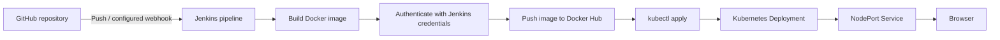

# Jenkins CI/CD Pipeline with Docker and Kubernetes

A hands-on CI/CD project that automates the delivery of a small Nginx website. A change pushed to GitHub can trigger a Jenkins job, which builds a Docker image, publishes it to Docker Hub, and deploys the application to a Kubernetes cluster.

> **Project scope:** This is a learning / portfolio implementation. It demonstrates a basic build, image-publish and Kubernetes deployment workflow; it is not presented as a production-hardened delivery platform.

## Delivery workflow



## What the pipeline does

The Declarative Jenkinsfile contains these stages:

1. **Build Docker image** — builds the Nginx image using the repository Dockerfile.
2. **Login to Docker Hub** — reads the registry username and token/password from a Jenkins credential named `docker-hub-creds`.
3. **Push image** — publishes `joshv69517/my-html-app:latest`.
4. **Deploy to Kubernetes** — applies `deployment.yaml` and `service.yaml` using `kubectl`.

The Jenkinsfile uses Windows `bat` steps, so the configured Jenkins agent must be a Windows agent with Docker CLI and kubectl available. The GitHub webhook or SCM trigger is configured in the Jenkins job; it is not declared inside the Jenkinsfile.

## Technology stack

| Area | Technology |
|---|---|
| Source control | Git, GitHub |
| CI/CD | Jenkins Declarative Pipeline |
| Containerization | Docker |
| Image registry | Docker Hub |
| Web server | Nginx |
| Orchestration | Kubernetes |
| Local cluster used for validation | Minikube |
| Deployment access | Kubernetes NodePort |

## Repository structure

```text
.
├── .dockerignore
├── Dockerfile
├── Jenkinsfile
├── README.md
├── deployment.yaml
├── index.html
└── service.yaml
```

## Prerequisites

- Jenkins with a Windows build agent.
- Docker Desktop running and accessible from the Jenkins agent.
- kubectl installed and configured for the target Kubernetes cluster.
- A running Minikube cluster, with the Jenkins agent able to reach its Kubernetes API.
- A Docker Hub account and repository named `my-html-app`.

Check the tools and cluster from the same Windows account / agent that runs the pipeline:

```powershell
docker version
kubectl version --client
kubectl config current-context
kubectl get nodes
minikube status
```

## Jenkins configuration

1. Add a Jenkins credential of type **Username with password**.
2. Set its credential ID to `docker-hub-creds`.
3. Use your Docker Hub username as the username and a Docker Hub access token as the password.
4. Configure the Jenkins Pipeline job to use this GitHub repository and the `main` branch.
5. Configure a GitHub webhook or the SCM trigger supported by your Jenkins job.
6. Ensure the Jenkins agent has access to Docker Desktop and the intended Minikube context.

Never commit Docker Hub tokens, passwords, kubeconfig files or other credentials to this repository.

## Run and verify

The Jenkins pipeline applies the Kubernetes manifests after publishing the image. To inspect the resulting resources:

```powershell
kubectl get deployments
kubectl get pods -l app=my-html-app
kubectl get services my-html-service
kubectl rollout status deployment/my-html-app
```

The Service exposes TCP port **30007** as a NodePort. With Minikube running, retrieve a reachable URL with:

```powershell
minikube service my-html-service --url
```

You can also inspect the service and nodes directly:

```powershell
kubectl describe service my-html-service
kubectl get nodes -o wide
```

## Configuration notes and limitations

- The current pipeline publishes the mutable `latest` tag. A stronger release workflow would also tag each image with the Git commit SHA or Jenkins build number and deploy that immutable tag.
- The pipeline does not currently include automated unit tests, image vulnerability scanning, manifest policy checks or a deployment approval gate.
- Kubernetes resources are applied directly with `kubectl`; this project does not use GitOps for this application.
- The NodePort service is intended for a local learning environment, not direct public production exposure.
- Jenkins credentials protect registry authentication; cluster access should also be scoped to the minimum Kubernetes permissions required.

## Next improvements

- Add immutable image tags and update the deployment to use the exact build tag.
- Add a post-deployment smoke test that checks the HTTP response.
- Add Trivy image scanning and fail the pipeline on an agreed severity threshold.
- Add a rollback stage based on a known-good image tag.
- Move Kubernetes deployment to a dedicated, least-privilege service account.

## Author

**JOSH801251** · [GitHub profile](https://github.com/JOSH801251)
